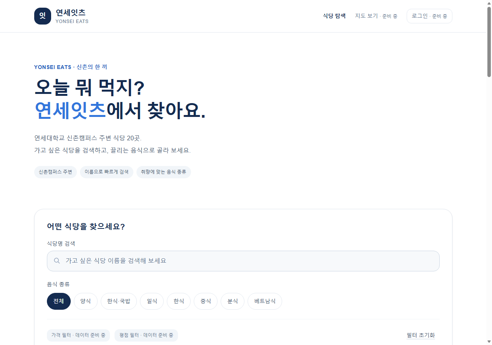
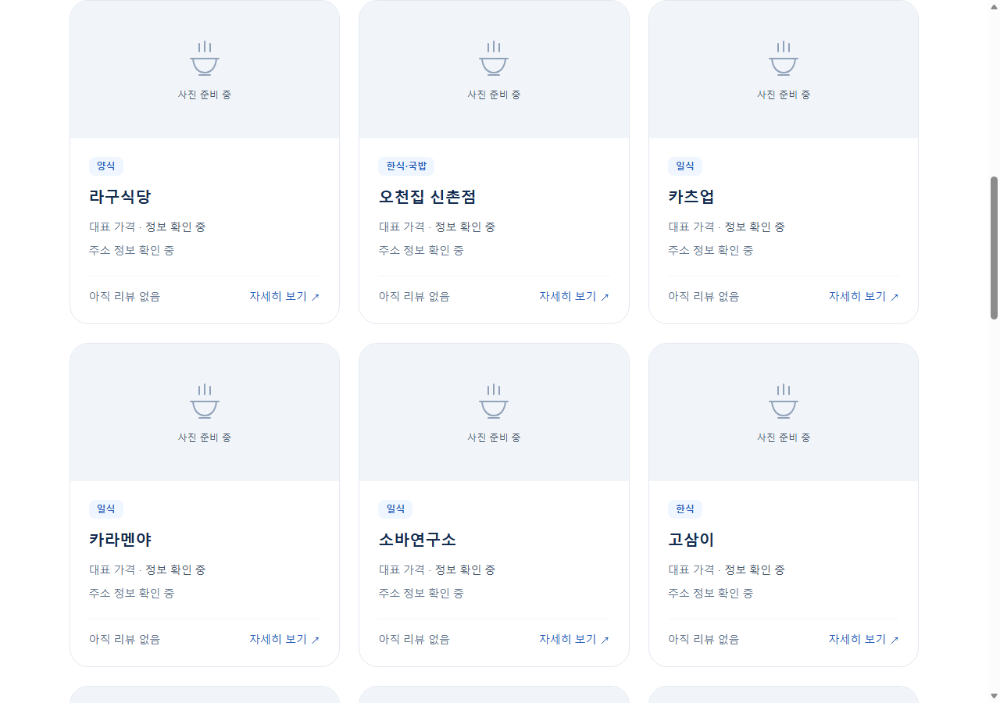
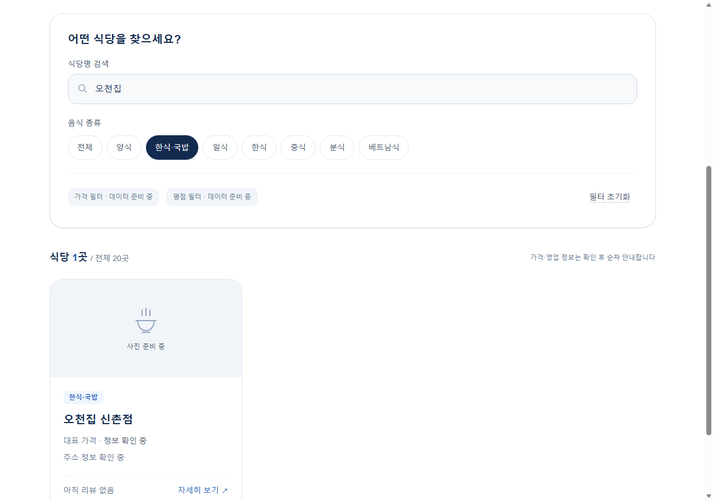
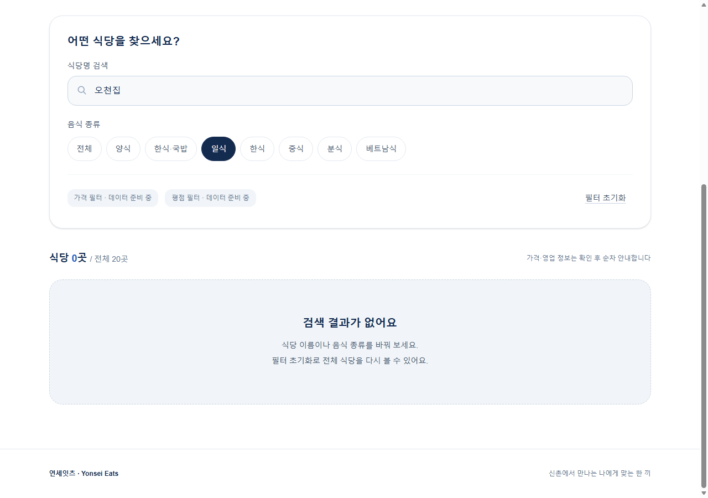
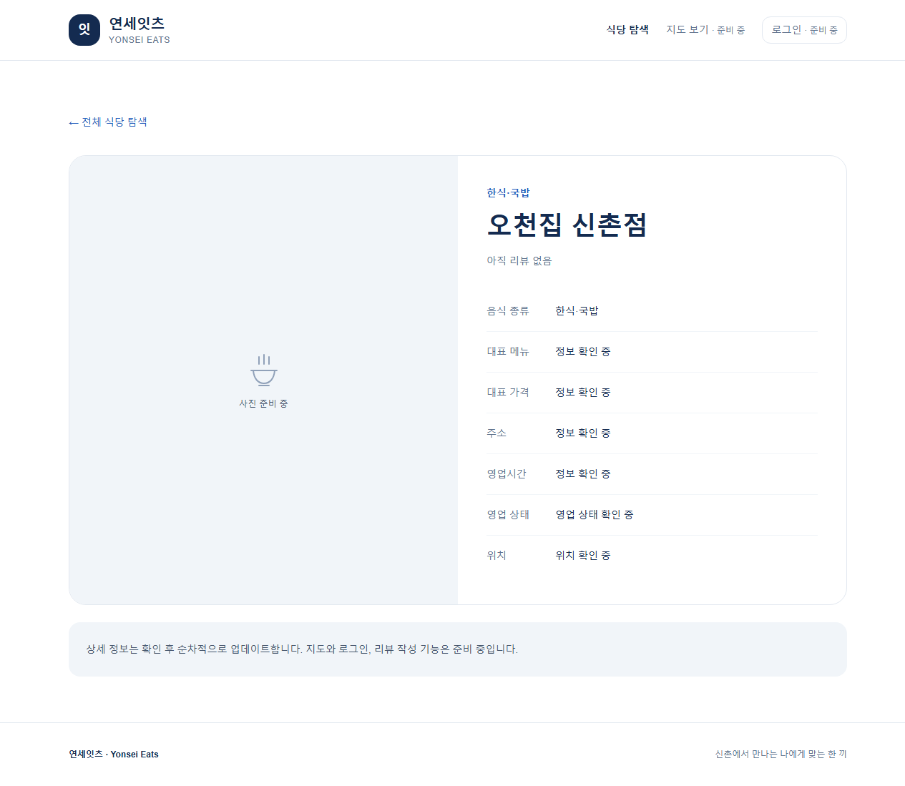
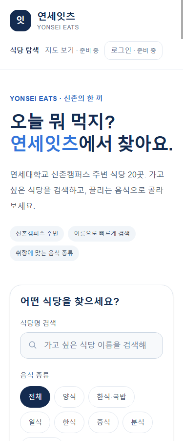
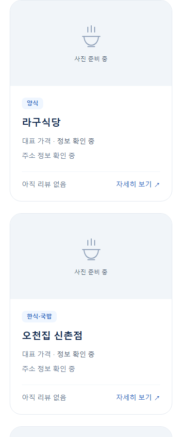
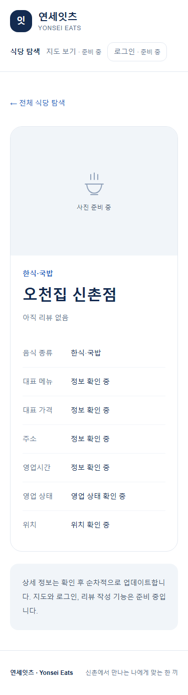

# 연세잇츠(Yonsei Eats) Phase 1 작업완료보고서

- 작성일 및 실행 화면 캡처일: 2026-10-27 (Asia/Seoul)
- 단계: Phase 1 — 메인 페이지 및 식당 탐색 UI
- 상태: 구현·개발 검증 완료. Phase 2 미착수, Git commit·push·Vercel 배포 미실행.
- 실행 환경: Windows, Node.js 26.7.0, npm 11.19.0, 로컬 production 서버 및 Microsoft Edge headless

## 1. 작업 목표와 범위

연세대학교 신촌캠퍼스 주변의 승인된 식당 20곳을 탐색할 수 있는 반응형 웹 UI를 구현했다. 기존 Next.js App Router·TypeScript·React·Tailwind CSS와 로컬 JSON 데이터를 사용했다. 이번 단계에서는 Supabase DB/Auth·NAVER Maps·실제 리뷰·즐겨찾기를 연결하지 않았다.

현재 설치 버전은 Next.js 16.4.3, React 19.3.1, Tailwind CSS 4.3.3, TypeScript 5.9.3이다. 외부 키 없이 목록·검색·기본 상세를 실행할 수 있다.

## 2. 구현 완료 항목

| 항목 | 구현 결과 |
|---|---|
| 메인 화면 | 연세잇츠 로고/서비스명, 소개, 검색창, 종류 필터, 카드 목록, 공통 헤더/푸터 |
| 초기 식당 | data/restaurants.json의 20곳 모두 표시. 정육면체 제외, 오천집 신촌점·더도이축산직영점 신촌점 포함 |
| 검색·필터 | 식당명 검색, 원본 7개 음식 종류 필터, AND 적용, 초기화, 결과 개수, 빈 결과 안내 |
| 상태 유지 | q/category URL 반영, 새로고침·브라우저 뒤로가기 시 조건 보존 |
| 기본 상세 | /restaurants/[id] 20개 상세 페이지, 잘못된 ID의 404 안내 |
| 반응형 | 375px에서 1열, 1280px에서 3열. 검사한 화면에서 가로 넘침 없음 |
| 미구현 기능 안내 | 지도·로그인·가격/평점 필터를 준비 중으로 표시하고 비활성화 |
| 데이터 정직성 | 미확인 값 null 보존, 정보/위치/영업 상태 확인 중, 아직 리뷰 없음, 공통 사진 플레이스홀더 |

음식 종류는 원본의 정확한 분류를 유지한다. '한식·국밥'은 '한식'과 별개 필터다. 상세의 '전체 식당 탐색' 링크는 전체 목록으로 이동하며, 필터를 유지한 복귀는 브라우저 뒤로가기로 확인했다.

## 3. 주요 생성·수정 파일

| 영역 | 파일 |
|---|---|
| 페이지·레이아웃 | src/app/page.tsx, layout.tsx, globals.css, not-found.tsx, restaurants/[id]/page.tsx |
| 공통 UI | src/components/site-header.tsx, restaurant-card.tsx, restaurant-explorer.tsx |
| 데이터 계층 | src/lib/restaurants.ts |
| 테스트 | tests/restaurants.test.mjs, http-smoke.mjs, browser-smoke.mjs |
| 문서 | docs/spec.md, implementation-plan.md, phase1-plan.md, development-log.md, README.md |
| 실행 명령 | package.json의 test/test:http/test:browser 스크립트 추가 |

기존 식당 JSON·원본 v2·package-lock.json·Next/TypeScript/ESLint 설정은 보존했다. 의존성을 추가하거나 버전을 변경하지 않았다. 환경 변수의 비밀 값은 보고서와 화면에 포함하지 않는다.

## 4. 검증 결과

### Phase 1 개발 완료 당시 실행한 검증

아래 결과는 docs/development-log.md에 기록된 실제 실행 결과다. 이번 보고서 작성 과정에서 lint·build·typecheck·전체 테스트를 다시 실행하지는 않았다.

| 명령·검사 | 결과 |
|---|---|
| npm.cmd test | exit 0, 6건 통과/0건 실패 |
| npm.cmd run lint | exit 0, lint 오류·경고 없음 |
| npm.cmd run typecheck | exit 0, next typegen 및 tsc --noEmit 통과 |
| npm.cmd run build | exit 0, 홈 서버 렌더링 및 상세 20곳 정적 생성 |
| npm.cmd run test:http | exit 0, SSR 카드 20개·상세 20개·URL 복합 필터·잘못된 ID 404 |
| npm.cmd run test:browser | exit 0, production Edge에서 검색·종류·AND·초기화·빈 결과·상세 이동·URL 복원 검사 |
| 브라우저 화면 검사 | 375px 1열/1280px 3열, 가로 넘침 없음, 입력 포커스 확인, 수집된 실행/console 오류 0건 |
| 보존·변경 검사 | 데이터·lockfile·주요 설정 변경 없음, git diff --check 통과 |

### 이번 보고서 작성 시 새로 확인한 항목

기존 production build를 로컬 127.0.0.1:3101에서 실행하고, 별도 임시 프로필의 Edge로 실제 화면 8장을 캡처했다. 카드 20개 렌더링, 복합 검색 1건, 조건 불일치 0건, 식당 상세 표시를 확인했다. 캡처 중 수집된 브라우저 실행 오류는 0건이었다. 화면 캡처는 목업이나 AI 생성 이미지가 아니다.

실제 모바일 기기, 스크린리더·전체 키보드 탐색, Node 24, DB/RLS/OAuth/지도 테스트는 수행하지 않았다. 375px 화면은 headless 브라우저의 모바일 viewport 검사다.

## 5. AI 도구 실제 활용 및 오류 해결

| 도구·역할 | 실제 사용 |
|---|---|
| Superpowers | brainstorming으로 범위 검토, writing-plans로 구현 계획, TDD로 실패 후 구현, 검토·완료 증거 확인 |
| Context7 | Next.js·React·Tailwind 공식 문서의 resolve 3회/query 3회. 설치 Next 문서로 API 교차 확인 |
| Caveman/Cavecrew | 일반 Codex agent에 investigator·builder·reviewer 역할 지침을 부여. 네이티브 preset은 사용하지 않음 |
| 개발 검증 | Node 내장 테스트, HTTP 검사, Edge headless/CDP로 실제 상호작용·레이아웃 확인 |
| 보고서 제작 | verification-before-completion 스킬 읽기, 로컬 production 재실행, 실제 화면 캡처·이미지 확인·보고서 생성 |

데이터 계층은 모듈 미존재 실패 후 5건 통과했고, SSR 검사는 카드 0개 실패 후 20개로 통과했다. 검토에서 작은 파란 글씨의 대비 부족을 발견해 전용 회귀 검사 실패를 확인한 뒤 작은 글씨용 #245EBC를 적용했다. 지정 강조색 #3276DC는 유지했다.

초기 Chrome DevTools timeout은 원인을 확정하지 못해 Edge로 대체했다. 브라우저 검사 선택자의 따옴표 오류는 JSON 인코딩으로 수정했다. Node 테스트의 MODULE_TYPELESS_PACKAGE_JSON 경고는 비치명적이며 남아 있다. 실패한 실행을 성공으로 기록하지 않았다. 이번 보고서 제작에서는 Context7이나 서브에이전트를 새로 호출하지 않았으며 위 활용 내역은 실제 개발 기록에 근거한다.

## 6. 실행 화면

PC 화면 폭은 1280px, 모바일 화면 폭은 375px이다. 홈·목록·검색·빈 결과는 실제 viewport를 캡처했고, 상세는 내용 전체를 캡처했다. 사진 준비 이미지는 실제 식당 사진이 아니라 UI 플레이스홀더다.

### 6.1 PC 메인 화면

### 6.2 PC 식당 카드 목록 — 3열

### 6.3 복합 검색 — 오천집 + 한식·국밥, 1곳

### 6.4 검색 조건 불일치 — 오천집 + 일식, 0곳

### 6.5 PC 기본 상세 — 오천집 신촌점

### 6.6 모바일 메인 화면

### 6.7 모바일 카드 목록 — 1열

### 6.8 모바일 기본 상세

## 7. 미완료 사항과 후속 단계

Supabase DB/Auth·RLS·Google/NAVER 로그인·지도·실제 리뷰·즐겨찾기·실제 가격/평점 필터·Vercel 배포는 미구현이다. 식당 상세 정보의 검증은 승인된 정책에 따라 개발 완료 후 별도 진행한다. Node 24 환경 및 실제 기기 검증도 남아 있다.

이후 단계에는 Supabase 프로젝트, OAuth 앱·callback, NAVER Maps 키와 허용 도메인 등이 필요하다. 비밀 값은 Git이나 보고서에 넣지 않는다. Phase 2는 사용자 승인 전 시작하지 않는다.

## 8. 로컬 실행 방법

프로젝트 폴더에서 `npm.cmd run dev` 후 http://localhost:3000 에 접속한다. macOS/Linux에서는 npm 명령을 사용할 수 있다. production은 `npm.cmd run build` 후 `npm.cmd start`로 실행한다. 이번 캡처에 사용한 3101 포트는 검증 전용이며 실제 배포 주소가 아니다.

참고 문서: [프로젝트 명세](spec.md), [Phase 1 계획](phase1-plan.md), [식당 데이터 정책](restaurant-data.md), [실제 개발 기록](development-log.md).
