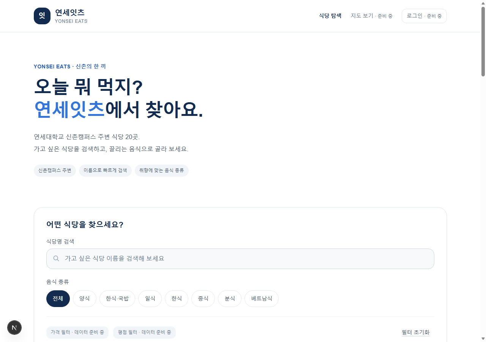
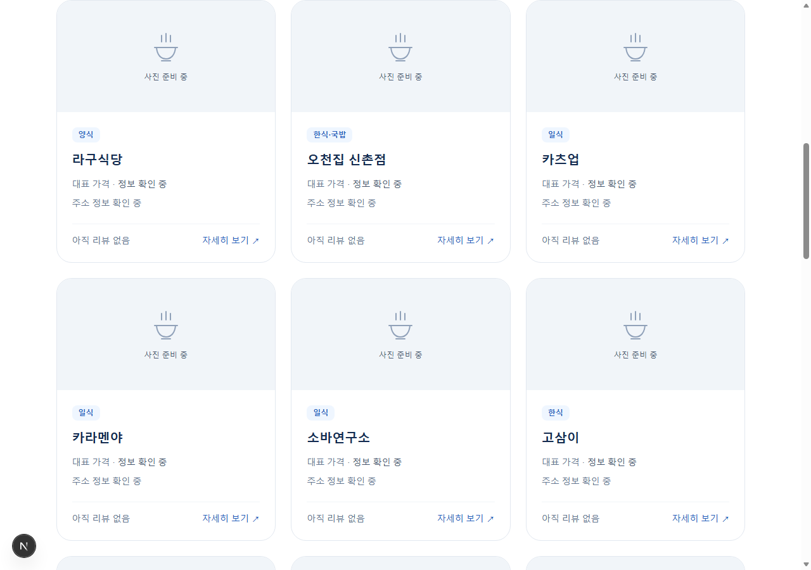
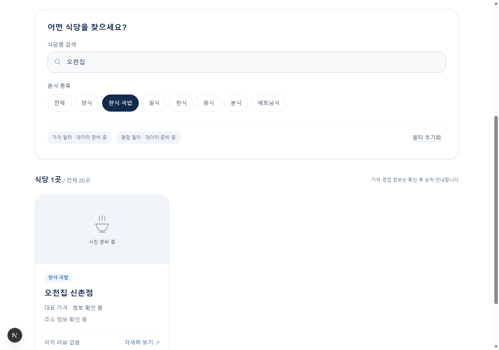
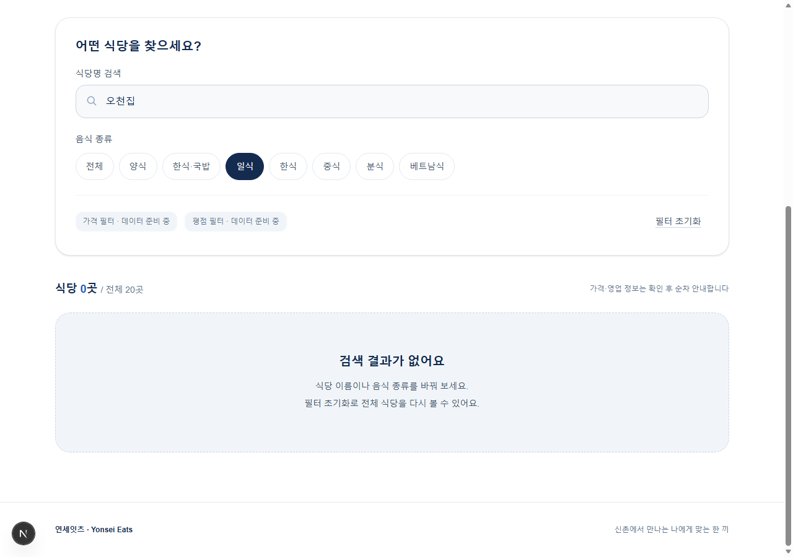
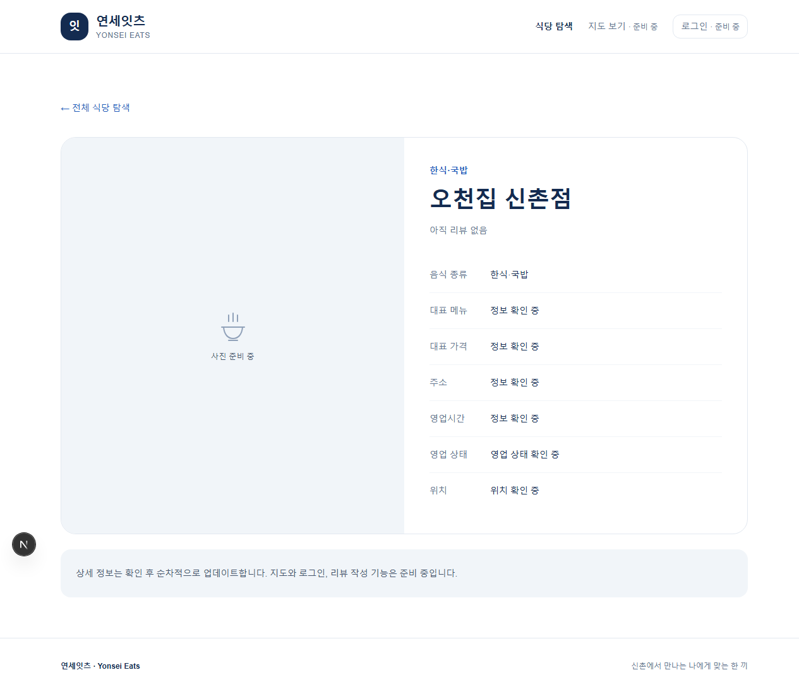
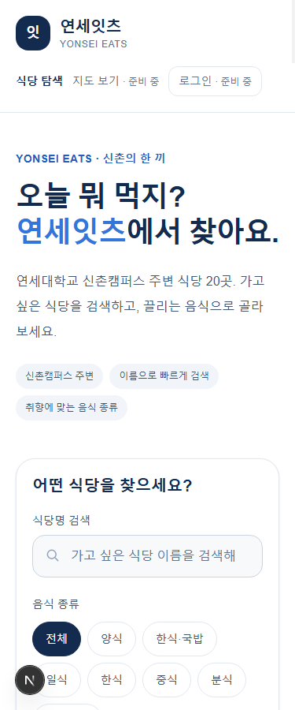
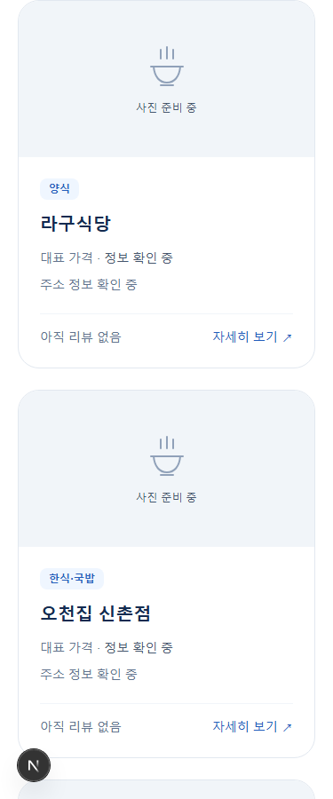
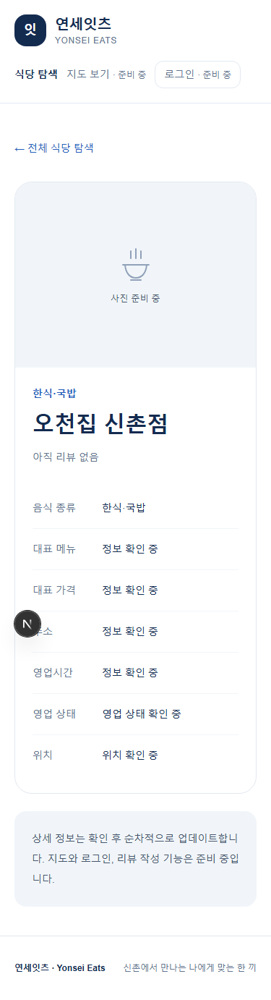

# 연세잇츠 Phase 1 작업완료보고서

## 재작성본 · 메인 페이지 및 식당 탐색 UI

| 구분 | 내용 |
|---|---|
| 프로젝트 | 연세잇츠(Yonsei Eats) |
| 작성 기준일 | 2026년 10월 27일, 한국 시간 |
| 대상 단계 | Phase 1 — 로컬 데이터 기반 식당 탐색 UI |
| 완료 상태 | 요청한 Phase 1 기능 구현 완료. Phase 2 미착수 |
| 보고서 성격 | 현재 코드·실행 상태를 확인해 새로 작성한 보고서 |
| 실행 화면 | 현재 개발 서버에서 새로 캡처한 PC·모바일 화면 8장 |

## 1. 개발 목적

연세대학교 신촌캠퍼스 주변에서 식사할 식당을 쉽게 찾도록, 승인된 식당 20곳을 탐색하는 반응형 웹 화면을 구현했다. 사용자는 식당 이름과 음식 종류로 목록을 좁히고, 카드를 눌러 기본 상세 정보를 볼 수 있다.

이번 단계의 범위는 프런트엔드 UI와 로컬 JSON 기반 탐색이다. 실제 DB·소셜 로그인·지도·리뷰·즐겨찾기를 연결한 서비스 완성을 의미하지 않는다.

## 2. 구현 결과

| 요구사항 | 구현 내용 | 상태 |
|---|---|---|
| 메인 페이지 | 서비스명·소개·탐색 메뉴·검색·필터·식당 목록 | 완료 |
| 식당 카드 | 승인된 20곳 전체, 이름·종류·미확인 정보 안내 | 완료 |
| 식당명 검색 | 입력에 따른 이름 검색, 앞뒤 공백 정리·대소문자 무시 | 완료 |
| 음식 종류 | 원본 7개 분류와 전체 선택, 이름 검색과 AND 적용 | 완료 |
| 검색 보조 UI | 초기화, 결과 개수, 결과 없음 안내 | 완료 |
| 상태 보존 | URL q/category 반영, 새로고침·브라우저 뒤로가기 | 완료 |
| 기본 상세 | /restaurants/[id], 승인된 ID 20개, 잘못된 ID 404 | 완료 |
| 반응형 | 검사한 375px 1열·1280px 3열, 가로 넘침 없음 | 확인 |
| 준비 중 기능 | 지도·로그인·가격·평점 필터를 비활성화하고 안내 | 완료 |

음식 종류는 양식, 한식·국밥, 일식, 한식, 중식, 분식, 베트남식이다. 원본 분류를 보존했으므로 '한식·국밥'과 '한식'은 별개 선택이다. 상세의 '전체 식당 탐색' 링크는 전체 목록으로 이동하며 조건을 유지한 복귀는 브라우저 뒤로가기로 동작한다.

## 3. 데이터 정확성 정책

- 초기 기준은 data/restaurants.json의 승인된 20곳이다. 정육면체는 제외했고 오천집 신촌점·더도이축산직영점 신촌점을 포함했다.
- 상세 검증 여부와 초기 등록 자격을 분리하여 pending 상태의 식당도 목록과 상세에 표시한다.
- 미확인 주소·좌표·메뉴·가격·영업시간·사진 등은 null을 유지한다. 0원·가짜 주소·임의 별점·거리·영업시간을 생성하지 않는다.
- 자체 리뷰가 없으면 '아직 리뷰 없음', 알 수 없는 정보는 '정보 확인 중', 좌표와 영업 상태는 각각 '위치 확인 중'·'영업 상태 확인 중'으로 안내한다.
- 식당 사진을 확보하지 않았으므로 모든 카드에 동일한 그래픽 플레이스홀더를 사용한다. 실제 식당 사진으로 오인시키지 않는다.
- 상세 검증과 출처·확인일 갱신은 개발 완료 후 별도 진행한다. v3/v4의 검증·3곳 제한은 초기 등록 기준이 아니다.

## 4. 구현 구조와 변경 파일

Next.js 16.4.3, React 19.3.1, TypeScript 5.9.3, Tailwind CSS 4.3.3을 사용한다. 서버에서 JSON을 읽고, 상호작용이 필요한 검색·필터는 클라이언트 컴포넌트로 분리했다. 별도 데이터 API나 UI 프레임워크를 추가하지 않았다.

| 영역 | 구현 파일 |
|---|---|
| 홈·공통 레이아웃 | src/app/page.tsx, layout.tsx, globals.css |
| 상세·404 | src/app/restaurants/[id]/page.tsx, src/app/not-found.tsx |
| 공통 UI | src/components/site-header.tsx, restaurant-card.tsx, restaurant-explorer.tsx |
| 데이터·검색 | src/lib/restaurants.ts |
| 테스트 | tests/restaurants.test.mjs, http-smoke.mjs, browser-smoke.mjs |
| 문서·실행 명령 | README.md, docs/spec.md, implementation-plan.md, phase1-plan.md, development-log.md, package.json |

기존 식당 JSON·원본 v2·의존성 lockfile을 보존했다. Phase 1에서는 테스트 명령만 추가했으며 패키지 버전은 변경하지 않았다. 비밀 키나 환경 변수 값은 보고서에 포함하지 않는다.

## 5. 검증 결과와 증거 범위

### 5.1 이번 재작성에서 새로 실행한 검사

| 검사 | 실제 결과 |
|---|---|
| npm.cmd test | exit 0, 6건 통과·0건 실패 |
| npm.cmd run lint | exit 0, 오류·경고 출력 없음 |
| 개발 서버 HTTP 요청 | HTTP 200, 서버 렌더링 카드 20개 |
| 새 실행 화면 캡처 | PC·모바일 총 8장, 모든 캡처 성공 |
| 캡처 중 화면 조건 검사 | 카드 20개, 복합 검색 1개, 조건 불일치 0개, 상세 상호 확인 |
| 캡처 중 브라우저 실행 오류 | 수집된 runtime 오류 0건 |

단위 테스트는 20곳 보존, 검색, 분류와 AND, 원본 불변성·null 보존, 가격 표시·ID 조회, 작은 글씨 색상 대비를 확인한다. Node의 MODULE_TYPELESS_PACKAGE_JSON 경고는 남아 있지만 종료 코드는 0이다.

### 5.2 Phase 1 개발 완료 당시의 검증 이력

| 명령 | 기록된 결과 | 이번 재작성에서 재실행 여부 |
|---|---|---|
| npm.cmd run typecheck | exit 0 | 재실행하지 않음 |
| npm.cmd run build | exit 0, 상세 20개 정적 생성 | 재실행하지 않음 |
| npm.cmd run test:http | exit 0, 상세 20개·복합 URL·404 확인 | 전체 검사 재실행하지 않음 |
| npm.cmd run test:browser | exit 0, production Edge 상호작용·모바일 viewport 검사 | 전체 검사 재실행하지 않음 |

이전 검증 이력은 docs/development-log.md의 실제 명령 기록에 근거한다. 이를 이번 실행 결과로 바꿔 표시하지 않았다. 이번 새 캡처의 대상은 production 서버가 아닌 현재 개발 서버 http://127.0.0.1:3000 이다.

실제 모바일 기기, 스크린리더·전체 키보드 탐색, Node 24, DB/RLS·OAuth·지도 기능은 검증하지 않았다. 모바일 화면은 Edge headless의 375px viewport다.

## 6. 오류 해결 및 품질 보완

| 발견 사항 | 처리 결과 |
|---|---|
| 작은 파란 글씨 대비 부족 | 회귀 검사 후 작은 글씨에 #245EBC 적용. 지정 강조색 #3276DC 유지 |
| Chrome DevTools 응답 timeout | 원인을 확정하지 않고 Edge로 대체하여 실제 검사 수행 |
| 브라우저 검사 선택자 인용 오류 | JSON 인코딩으로 수정 후 통과 |
| Windows npm ci의 SWC EPERM 및 next 명령 누락 | 잠금이 없는 시점 확인 후 lockfile 기반 357개 패키지 재설치. next 복원·HTTP 200·카드 20개 확인 |
| 실행 안내 혼동 | README에서 최초 설치와 일상 실행을 분리. 설치 실패 후 dev를 이어 실행하지 않도록 안내 |

SWC 파일 접근이 차단됐던 당시 원인은 확정하지 않았다. 파일 잠금·동기화·보안 프로그램 중 특정 원인이라고 단정하지 않는다. npm ci는 node_modules를 먼저 제거하므로 중간 실패가 실행 파일 누락으로 이어질 수 있음을 공식 npm 문서로 확인했다. 실행 중인 개발 서버를 종료한 뒤에만 의존성을 재설치하도록 안내했다.

## 7. AI 도구 활용

| 도구 | 개발 단계에서 실제 수행한 역할 |
|---|---|
| Superpowers | 범위 검토·구현 계획·실패 후 구현(TDD)·디버깅·검토·완료 증거 확인 |
| Context7 | Next.js·React·Tailwind 공식 문서 조회, 설치 Next 문서와 교차 확인. 복구 시 npm ci 동작 문서 조회 |
| Caveman/Cavecrew | 일반 Codex 서브에이전트에 investigator·builder·reviewer 지침을 부여해 조사·작은 데이터 계층 구현·독립 검토 |
| Node·Edge·CDP | 자동화 테스트, 실제 화면 조작, 반응형 검사·캡처 |

네이티브 Cavecrew preset이나 설치하지 않은 도구를 호출했다고 주장하지 않는다. 이번 재작성에서는 완료 증거 확인 스킬, 기존 기록 확인, 테스트·lint·실행 캡처·PDF 생성을 수행했다. Context7·서브에이전트는 이번 재작성에서 새로 호출하지 않았다.

## 8. 새 실행 화면

아래 화면은 모두 이번 재작성에서 새로 저장한 실제 실행 화면이다. 데스크톱 viewport는 1280×900, 모바일은 375×900이다. 상세 페이지는 내용 전체를 캡처하여 높이가 다르다. 개발 서버 화면에는 Next.js 개발 도구 표시가 나타날 수 있다.

### 화면 1. PC 메인

### 화면 2. PC 식당 카드 목록

### 화면 3. 복합 검색 — 오천집 + 한식·국밥

### 화면 4. 조건 불일치 — 오천집 + 일식

### 화면 5. PC 상세

### 화면 6. 모바일 메인

### 화면 7. 모바일 카드 목록

### 화면 8. 모바일 상세

## 9. 미완료 사항 및 다음 단계

Supabase 스키마·RLS·DB seed, Google/NAVER 인증, NAVER Maps, 실제 리뷰·별점·즐겨찾기, 가격/평점 필터 활성화와 배포는 이후 단계다. 상세 식당 자료의 검증도 후속 작업이며, 현재 빈 값을 임의로 채우지 않는다.

향후 Supabase 프로젝트·OAuth 앱/callback·Maps 키/허용 도메인 등이 필요하다. Phase 2는 사용자 승인 후 진행한다. Git commit·push·Vercel 배포는 자동 실행하지 않았다.

## 10. 실행 및 인계

이미 설치된 현재 환경에서는 `npm.cmd run dev`로 실행하고 http://localhost:3000 에 접속한다. 처음 설치하거나 재설치할 때만 실행 중인 서버를 종료한 뒤 `npm.cmd ci`를 실행한다. 설치 실패 시 다음 명령으로 진행하지 않는다.

이 문서는 기존 phase1-completion-report.*를 수정하거나 재사용한 파일이 아닌 별도의 재작성 산출물이다. 기존 보고서는 보존했다. 이번 작업은 보고서·화면·기록만 추가하며 앱 코드와 데이터는 변경하지 않는다.
